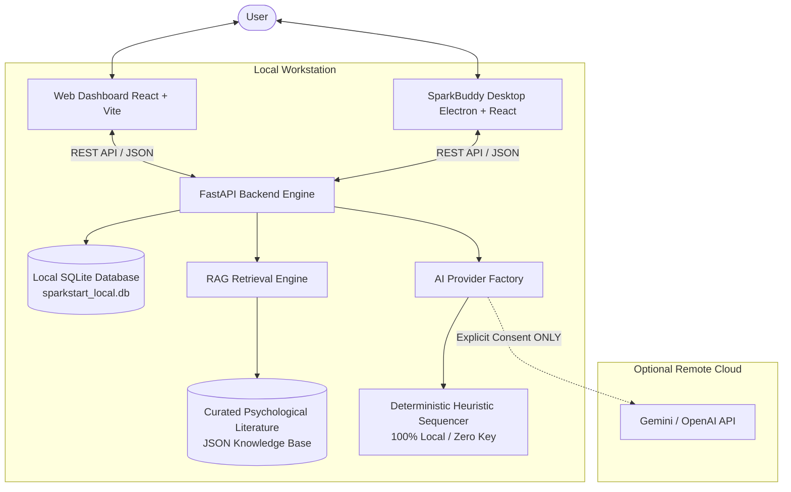

# SparkStart & SparkBuddy Architecture Specification

## 1. System Overview

SparkStart is an adaptive, low-pressure task sequencing system engineered to alleviate executive dysfunction, cognitive overload, and task initiation friction. It pairs a full-stack web dashboard with **SparkBuddy**, an Electron-based floating desktop companion.

The core technical differentiator is **The Task Sequencer**, a grounded RAG (Retrieval-Augmented Generation) pipeline that rejects intimidating 50-step checklists in favor of **single-action micro-commitments** (2–5 minute starter actions) aligned with self-reported energy levels.



---

## 2. Monorepo Structure

```
sparkstart/
├── apps/
│   ├── web/                    # React 18, Vite, Tailwind CSS Web Dashboard
│   │   ├── src/components/     # EnergyCheckIn, MicroTaskCard, QuickStarter, TaskList, etc.
│   │   └── src/services/api.ts # Typesafe REST client with offline fallback
│   └── desktop/                # Electron + React + TypeScript Desktop Floating Companion
│       ├── electron/main.ts    # Frameless, transparent, always-on-top BrowserWindow
│       ├── electron/preload.ts # ContextIsolation IPC bridge
│       └── src/components/     # MascotSprout, CompanionBubble, MiniRestTimer, etc.
├── services/
│   └── api/                    # Python 3.14 + FastAPI Task Sequencer Backend
│       ├── ai/                 # BaseAIProvider, MockProvider, GeminiProvider, OpenAIProvider
│       ├── rag/                # RAGEngine: Chunking, TF-IDF / Cosine Vector Indexing
│       ├── storage/            # SQLite repository for local-first tasks & preferences
│       └── main.py             # FastAPI entrypoint & CORS middleware
├── packages/
│   └── shared/                 # Shared TypeScript domain models & interfaces
├── knowledge/
│   └── sources/                # Grounded psychological literature on task initiation & pacing
├── docs/                       # Architecture, Privacy, Testing, Proposal Deck, Demo Script
└── tests/                      # Automated Pytest suite
```

---

## 3. The Task Sequencer & RAG Pipeline

Traditional LLM productivity tools generate large, overwhelming multi-step plans. SparkStart's sequencer does the reverse: it uses single-target scaffolding to compress goals down to the lowest activation energy threshold.

### RAG Pipeline Flow:
1. **Query Formulation**: Combines user task description (e.g., *"Complete DBMS Assignment"*), current energy level (*low/medium/high/unsure*), and any optional mental obstacle (*"Brain fog"*).
2. **Knowledge Retrieval**: Searches the curated psychological literature base (Gollwitzer, Sweller, Barkley, Miserandino, Sonnentag) using keyword-boosted cosine similarity.
3. **Prompt Augmentation**: Augments the sequencer prompt with the top-3 literature chunks and instructions.
4. **Structured JSON Validation**: Enforces strict schema output containing:
   - `actionText`: The single physical starter action.
   - `suggestedDurationMinutes`: 2 to 3 minutes for low energy; 5 to 10 for medium; 12 to 15 for high.
   - `whyItIsManageable`: Psychological rationale reducing intimidation.
   - `alternativeSmallerStep`: Immediate fallback action if the user experiences resistance.
   - `sourceReferences`: List of verifiable academic literature sources.
5. **Adaptive Shrink Loop ("Too Big")**: If the user clicks "Too Big", the sequencer immediately decomposes the step down to a near-zero demand physical touchpoint (e.g. *"Just open the file and take 3 deep breaths"*).

---

## 4. Electron Desktop Companion Architecture

SparkBuddy is designed to float unobtrusively above IDEs (VS Code, JetBrains), web browsers, and document editors.

### Security Implementation:
- `nodeIntegration: false`: Renderer processes cannot execute arbitrary Node.js APIs.
- `contextIsolation: true`: Preload script exposes only strictly validated, typed methods (`sparkBuddyAPI`).
- `sandbox: true`: Standard browser sandbox applied to renderer.
- Remote content loading is blocked.

### Window & Position Management:
- Frameless, translucent window with custom SVG sprout mascot.
- Screen coordinates `(x, y)` are saved to `%APPDATA%/sparkstart/sparkbuddy-bounds.json` on move and restored on launch across multi-monitor setups.
- Non-focus-stealing native notifications respect configured quiet hours and global snooze periods.

